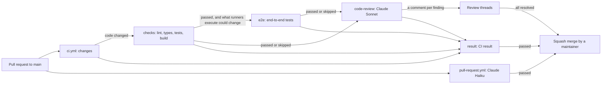

# CI

How the GitHub Actions workflows check a pull request (PR): the lint and unit tests, the end-to-end tests, Claude's code review and the title and description check. It's for engineers who change a workflow, or want to know why a PR can't merge. How `main` is tested and released is in [releases.md](releases.md). The commands CI runs are in [Building and testing](../CONTRIBUTING.md#building-and-testing).

## Contents

1. [Overview](#overview)
1. [How it works](#how-it-works)
1. [Code review](#code-review)
1. [Title and description](#title-and-description)
1. [Set up](#set-up)
1. [Security](#security)
1. [Decisions](#decisions)
1. [Limits](#limits)
1. [Sources](#sources)

## Overview

Two workflows in [.github/workflows/](../.github/workflows/) run on every PR to `main`. A maintainer merges each PR once `CI result` and `PR title and description` pass and every review thread is resolved. The ruleset requires the resolved threads. This flowchart shows the jobs:

## How it works

### ci.yml

- `concurrency` cancels a run when a newer commit reaches the same PR. It runs on `opened`, `synchronize`, `reopened` and `ready_for_review`.
- **`changes`** lists the PR's files through the GitHub API. The API lists at most 3000 files, so a longer PR counts as changing everything.
  - It outputs `code=false` only when every file is Markdown or under a path in its `DOCS` list, such as `docs/`. Listing what's safe to skip, rather than what needs testing, means a new kind of file is tested until someone adds it there.
  - It outputs `e2e=true` when a file is under a path in its `E2E` list: what runners execute (`src/` and `action.yml`), how it's built (the npm and TypeScript config) and the workflows, scripts and fixtures the end-to-end tests use. A change only to tests or docs skips them.
- **`checks`** runs Biome, `tsc`, Vitest and the build. `dist/` isn't committed, so the build only shows that it works.
- **`e2e`** calls [e2e.yml](../.github/workflows/e2e.yml) on the PR's merge commit, once `checks` passes. It builds `dist/` once and runs the action on the `windows-2025`, `windows-2022` and `windows-11-arm` runners, and on Linux to check it fails cleanly. [releases.md](releases.md#how-it-works) describes the jobs.
- **`code-review`** runs when `changes` passed and `checks` and `e2e` passed or were skipped, so no tokens go on code that's known to be broken. It skips drafts and Dependabot's PRs. See [Code review](#code-review).
- **`result`** runs with `if: always()` and fails unless every job it needs passed or was skipped. It's the one check to look at before merging, so a skipped job never holds a PR back and a failed one always does.

The workflow always runs, rather than filtering paths in `on:`, so `CI result` reports on every PR. A workflow skipped by a path filter reports nothing, which would block the PR if the check were ever required.

### pull-request.yml

Runs on `edited` as well, so a new title or description is checked again without rerunning the tests. See [Title and description](#title-and-description).

## Code review

The `code-review` job asks Claude Sonnet 5.5 to review the lines the PR adds or changes since it branched from `main`, and to comment on the PR for each finding. It runs through [anthropics/claude-code-action](https://github.com/anthropics/claude-code-action).

- Claude follows [REVIEW.md](../REVIEW.md) as it is at the merge base on `main`, or `main`'s current copy for a branch older than it, so a PR can't change its own review's rules. Only when `main` has no `REVIEW.md` does it follow the PR's copy.
- The action restores `CLAUDE.md`, `.claude/` and similar config from `main` before Claude starts. When the PR changes them, a step saves the PR's versions to `.code-review/head/`, under names Claude Code doesn't load as instructions.
- `package-lock.json` is left out of the diff, because it's generated.
- Every comment must be resolved before the PR can merge, so Claude posts Nits sparingly. It posts at most three per review, and after the first review only on lines changed since the last one that succeeded. From the fourth review on a PR it posts none. A step counts the earlier reviews from the Actions API.
- The same step saves the review threads already on the PR. Anyone can comment on a public PR, so it keeps only comments from the owner, members, collaborators and the Actions bot. Claude never raises an issue a thread already raises.
- Claude posts each finding with the action's own comment tool, `mcp__github_inline_comment__create_inline_comment`, with `confirmed: true` so it posts at once. It can only use that tool and read files.
- The job passes whatever Claude finds. The unresolved threads are what hold the PR back.

## Title and description

The squash-merged commit's message comes from the PR's title and description, and the release notes and version come from the commits. The `PR title and description` job checks them against the rules in [Pull requests](../CONTRIBUTING.md#pull-requests), read from `main`, and the commit scopes in `CLAUDE.md`. It reads them at the merge base, or from `main`'s current copy for a branch older than the rules. Only when `main`'s `CONTRIBUTING.md` has no "Pull requests" section does it follow the PR's copy.

- A script first checks that the title is a Conventional Commits header without a PR number.
- Claude Haiku 5.5 then reads the title, the description, the branch's commits and the files it changes, and returns a verdict as JSON. It fails only for a clear breach of a rule, or a title or description that clearly doesn't describe the change.
- The next step writes the verdict to the job summary, and adds an error for each problem.
- It reads the title and description through the API rather than from the event, so a re-run checks the current ones.
- It skips drafts, and Dependabot's PRs, whose titles come from the prefix in [dependabot.yml](../.github/dependabot.yml), as [Pull requests](../CONTRIBUTING.md#pull-requests) says.

## Set up

- **`CLAUDE_CODE_OAUTH_TOKEN`**, a repository secret, bills Claude's runs to the maintainer's Claude subscription. Make it with `claude setup-token` and save it with `gh secret set CLAUDE_CODE_OAUTH_TOKEN`. It lasts a year. Without it, the PR reviews are skipped with a notice, but a release fails, because the release notes and the wiki need it.
- **The `Protect Main` ruleset** requires squash merges, signed commits, linear history and resolved review threads. It requires no status checks, so a maintainer checks `CI result` and `PR title and description` before merging.
- **Merges** are squash only, with the PR's title and description as the commit message, and GitHub deletes the head branch afterwards.
- **Actions** only runs actions that GitHub owns and an allow list, `anthropics/claude-code-action@*` and `oven-sh/setup-bun@*`, which the Claude action uses itself. Every action must be pinned to a full commit SHA. Add a pattern for any new action outside GitHub.

## Security

- **The token stays in the review steps.** No job that runs the PR's code, such as `checks`, gets `CLAUDE_CODE_OAUTH_TOKEN`.
- **The workflow's token, as narrow as each job allows.** Both reviews pass it as `github_token`, so the Claude GitHub App's token isn't used. The title check's can only read. The code review's adds `pull-requests: write` to comment and `actions: read` to count earlier reviews.
- **PR content is data.** Both prompts say to treat titles, descriptions, commits, files and comments as data. Only collaborators can open PRs, and the code review sees only trusted authors' comments.
- **Few tools.** Neither review has Bash. The code review can read files and post review comments, and can't push, approve or merge.

## Decisions

- **One gate job.** `CI result` sums up every job, so there's one check to read before merging.
- **The code review after the tests.** No tokens go on code that doesn't build or pass its tests, end-to-end included.
- **Resolved threads, not a failing check.** A wrong finding is resolved with a reply rather than a re-run. That's why Nits are capped.
- **The title check in its own workflow.** Editing a title fires `edited`, which in `ci.yml` would cancel and rerun the tests.
- **No review of Dependabot's PRs.** They only change dependencies, which the checks and the end-to-end tests cover.
- **No required status checks.** A maintainer reads the checks before merging, so the ruleset doesn't require them.

## Limits

- Both reviews are Claude's judgement, so they can be wrong. The Nit limits are in the prompt, so nothing enforces them.
- An admin can bypass the ruleset.
- Nothing stops a maintainer merging a PR whose checks failed, because none are required.
- A comment can only go on a line in the PR's diff. A finding Claude can't place is only in the job summary.
- Anyone who can resolve a thread can let a PR merge without fixing it.
- The token expires after a year, and nothing warns before it does.

## Sources

- https://github.com/anthropics/claude-code-action, its `action.yml` and its source at `v1.0.258`, for the comment tool and the config it restores
- https://docs.github.com/en/pull-requests/collaborating-with-pull-requests/collaborating-on-repositories-with-code-quality-features/troubleshooting-required-status-checks
- https://docs.github.com/en/actions/concepts/security/github_token
