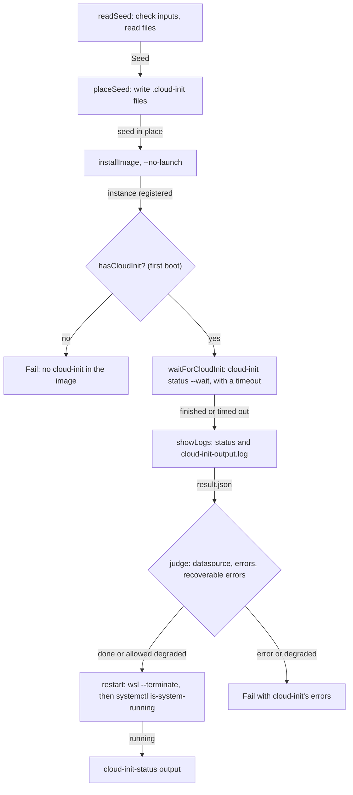

# cloud-init

How the action provisions a new instance with cloud-init user-data on its first boot, waits for it and judges the result. It's for engineers changing [`src/cloudinit/`](../src/cloudinit/) or the cloud-init steps in [`src/main.ts`](../src/main.ts).

## Contents

1. [Overview](#overview)
1. [How it works](#how-it-works)
1. [Interfaces](#interfaces)
1. [Errors and logging](#errors-and-logging)
1. [Security](#security)
1. [Decisions](#decisions)
1. [Limits](#limits)
1. [Sources](#sources)

## Overview

cloud-init's WSL datasource reads `%USERPROFILE%\.cloud-init\<instance>.user-data` and `<instance>.meta-data` on an instance's first boot. With `cloud-init-user-data`, the action puts those files in place before it [installs the distribution](distributions.md), starts the instance, waits for cloud-init and fails the step if cloud-init failed.

This flowchart shows the steps around the install:

`placeSeed` returns a function that removes the files it wrote, and `run` calls it in a `finally`, so the seed files go whether provisioning works or not.

## How it works

- **Inputs first:** `readSeed` in `main.ts` checks the cloud-init inputs before anything changes on the runner. User-data needs a distribution and WSL 2, and meta-data needs user-data. WSL 1 instances don't run an init system, so cloud-init never starts in them (observed on `windows-2022`).
- **Reading files:** `readInputFile` resolves paths against `GITHUB_WORKSPACE`. `normalise` removes a byte order mark and turns CRLF into LF, because a checkout on Windows can give the files CRLF line endings.
- **Meta-data:** the datasource needs meta-data with an `instance-id`. Without `cloud-init-meta-data`, `buildSeed` writes `instance-id: <instance-name>`.
- **Placing the seed:** `placeSeed` refuses to replace a seed file that's already there with other content, because on a self-hosted runner it's someone else's. An identical file is reused and left in place.
- **First boot:** `hasCloudInit` runs `command -v cloud-init` as root, which starts the instance, so systemd starts cloud-init with the seed in place. The probe found that `wsl -d <instance> -- <command>` doesn't run a distribution's first-run setup (observed).
- **Waiting:** `waitForCloudInit` runs `cloud-init status --wait` in one `wsl.exe` process, through `wslWithTimeout`, which kills it after `cloud-init-timeout` minutes. One process keeps a client attached for the whole wait, so WSL doesn't stop the instance as idle.
- **Judging:** `judge` reads `/var/lib/cloud/data/result.json`, which cloud-init writes when its last stage finishes. The datasource must be the WSL one, `errors` must be empty, and anything in `recoverable_errors` makes the run degraded.
- **Restarting:** `restart` runs `wsl --terminate`, so changes to `/etc/wsl.conf` such as the default user take effect, then runs `systemctl is-system-running --wait` when systemd is PID 1.

## Interfaces

- **Inputs:** `cloud-init-user-data`, `cloud-init-meta-data`, `cloud-init-timeout` and `allow-degraded`, described in [`action.yml`](../action.yml) and the README.
- **Output:** `cloud-init-status`, `done` or `degraded`.
- **`wslWithTimeout`** in [`src/wsl/exe.ts`](../src/wsl/exe.ts): runs `wsl.exe` with `child_process.spawn` and its `timeout` option, because `@actions/exec` can't stop a command that runs too long.

## Errors and logging

- cloud-init's `status --long` and the last 200 lines of `/var/log/cloud-init-output.log` are always shown, in a collapsed group, before the action judges the run.
- A timeout, an error, a degraded run without `allow-degraded`, a datasource other than WSL and a missing `result.json` each fail with their own message.
- systemd `degraded` fails unless `allow-degraded` is `true`, after showing `systemctl --failed`. Any other state that isn't `running`, such as `offline`, always fails.

## Security

- User-data can hold secrets. The action never prints it, and removes the seed files it wrote when it finishes.
- The seed files are only read by cloud-init inside the instance the action installed. The action never runs them itself.

## Decisions

- **Judge `result.json`, not `cloud-init status`.** After its first run, Ubuntu-26.04 turns cloud-init off, and `status` then reports `disabled-by-marker-file` whether or not it ran (observed).
- **Fail when the image has no cloud-init.** FedoraLinux-44's image has none (observed). Installing it before the first boot would make the action depend on each distribution's package manager, so the user chose to fail instead.
- **Fail on degraded by default.** A degraded run usually means user-data that needs fixing, such as a deprecated key. `allow-degraded` covers both cloud-init and systemd.
- **Don't run the distribution's first-run setup.** cloud-init and its `wsl.conf` decide the default user.

## Limits

- A distribution's image must include cloud-init, so FedoraLinux-44 can't be provisioned yet.
- A step-level timeout doesn't fire if WSL freezes the runner, so workflows still need a job-level `timeout-minutes`.
- The action can't tell whether systemd is enabled until the instance restarts, so an instance without systemd passes the systemd check.

## Sources

- https://cloudinit.readthedocs.io/en/latest/reference/datasources/wsl.html
- https://cloudinit.readthedocs.io/en/latest/reference/cli.html#status
- https://cloudinit.readthedocs.io/en/latest/explanation/failure_states.html
- https://nodejs.org/api/child_process.html#child_processspawncommand-args-options
