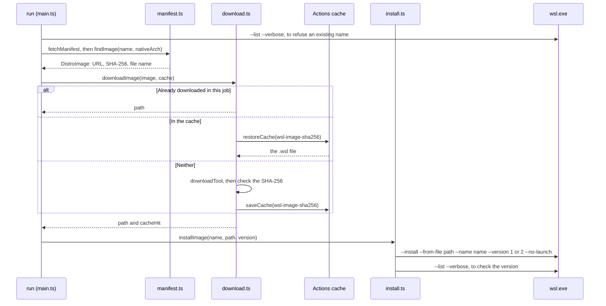

# Distributions

How the action downloads a distribution image and installs it as a WSL instance. It's for engineers changing [`src/distro/`](../src/distro/) or the distribution steps in [`src/main.ts`](../src/main.ts).

## Contents

1. [Overview](#overview)
1. [How it works](#how-it-works)
1. [Interfaces](#interfaces)
1. [Errors and logging](#errors-and-logging)
1. [Security](#security)
1. [Decisions](#decisions)
1. [Limits](#limits)
1. [Sources](#sources)

## Overview

When the `distribution` input names a distribution, the action installs it after [the WSL package](wsl-package.md) is ready. It reads Microsoft's [`DistributionInfo.json`](https://raw.githubusercontent.com/microsoft/WSL/master/distributions/DistributionInfo.json), the list `wsl --list --online` shows, downloads the `.wsl` image itself and installs it with `wsl --install --from-file`.

This sequence diagram shows one install:

## How it works

- **Inputs first:** `run` parses `wsl-version` and checks `instance-name` before it changes anything on the runner, so a typo fails in seconds.
- **Existing instances:** `listInstances` parses `wsl --list --verbose`. The action refuses to install over an instance with the same name, compared without regard to case, as WSL does.
- **Finding the image:** `findImage` looks through every group in `ModernDistributions` for the name, without regard to case. It picks `Amd64Url` or `Arm64Url` for the architecture `nativeArch` reports. Some entries give the hash in upper case or with a `0x` prefix, so it normalises them.
- **Downloading:** `downloadImage` keeps images in `RUNNER_TEMP\wsl-images\<sha256>\`. It reuses a file there when its hash matches, because an earlier step in the job may have downloaded it. Otherwise it tries the Actions cache, under the key `wsl-image-<sha256>`, and then downloads. A downloaded image must match the manifest's hash before it's used or cached.
- **Installing:** `installImage` runs `wsl --install --from-file <path> --name <instance> --version <1|2> --no-launch`. `--no-launch` registers the instance without starting it, so a later step decides what runs first. The action then checks `wsl --list --verbose` shows the instance with the requested version.

## Interfaces

- **Inputs:** `distribution`, `instance-name`, `wsl-version` and `cache`, described in [`action.yml`](../action.yml) and the README.
- **Outputs:** `instance-name`, and `cache-hit`, which is `true` only when the image came from the Actions cache.
- **`parseInstances`:** reads the lines of `wsl --list --verbose` that end in a WSL version. The header and the state column are translated on non-English Windows, so it doesn't read them.
- **`get`** in [`src/http.ts`](../src/http.ts): fetches the manifest with up to three tries and a 30-second timeout each.

## Errors and logging

- A distribution the manifest doesn't have fails with the list of names it does have.
- When `wsl --install` fails with WSL 2, an error code that means the runner can't run WSL 2's virtual machine, such as `HCS_E_HYPERV_NOT_INSTALLED`, becomes a message that says to set `wsl-version` to `1`. The `windows-11-arm` runners fail this way (observed).
- Other install failures name the WSL error code, and `wsl.exe`'s own output is in the log above them.
- A cache that can't be read or written is a warning, not a failure. Another job saving the same key at the same time is only a note.

## Security

- Every image must match the SHA-256 in Microsoft's manifest, whether it was downloaded, restored from the cache or left by an earlier step. A mismatched download is deleted.
- The cache key is the image's hash, so a cache entry can only ever serve the image the manifest lists now.
- The file name comes from the URL only when it's letters, digits, `.`, `_` and `-`, so a URL can't steer the download outside `RUNNER_TEMP`.
- The action trusts the manifest at `raw.githubusercontent.com` over HTTPS, as `wsl --install` does.

## Decisions

- **Download the image ourselves, not with `wsl --install <name>`.** It lets the action cache the image, retry downloads and check the hash itself, and it's the same path later inputs for custom images will use.
- **Fail rather than fall back to WSL 1.** `wsl-version` defaults to `2`, and a runner without virtualisation fails with an explanation. A workflow that wants WSL 1 says so, and works unchanged if the runner gains virtualisation.
- **No runner checks.** What WSL reports decides what works, so self-hosted runners and future images need no changes.

## Limits

- Only distributions in Microsoft's manifest can be installed so far.
- The instance is registered but never started, so nothing has run inside it yet, including the distribution's first-run setup.
- On self-hosted runners, instances stay registered after the job. A second run with the same `instance-name` fails until the instance is removed.
- The Actions cache is limited to 10 GB a repository, and an image is 150 to 450 MB.

## Sources

- https://learn.microsoft.com/en-us/windows/wsl/basic-commands
- https://learn.microsoft.com/en-us/windows/wsl/build-custom-distro
- https://github.com/microsoft/WSL/blob/master/distributions/DistributionInfo.json
- https://docs.github.com/en/actions/reference/workflows-and-actions/dependency-caching
