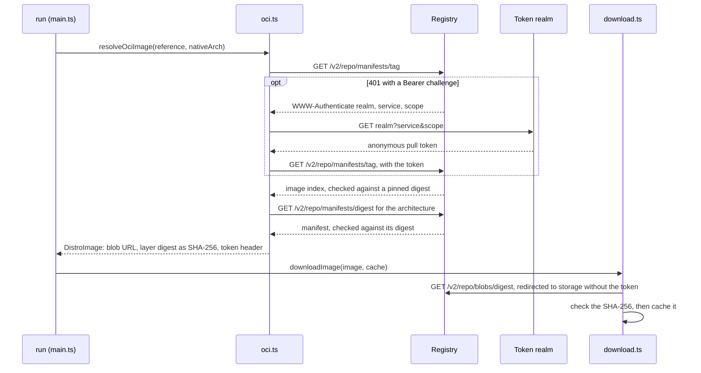

# Images

How the action installs an image that isn't in Microsoft's list: from a URL, an OCI registry or a file on the runner. It's for engineers changing [`src/distro/source.ts`](../src/distro/source.ts), [`src/distro/oci.ts`](../src/distro/oci.ts) or the `image` steps in [`src/main.ts`](../src/main.ts).

## Contents

1. [Overview](#overview)
1. [How it works](#how-it-works)
1. [Interfaces](#interfaces)
1. [Errors and logging](#errors-and-logging)
1. [Security](#security)
1. [Decisions](#decisions)
1. [Limits](#limits)
1. [Sources](#sources)

## Overview

The `image` input replaces `distribution` when the image comes from somewhere else. `parseImageSource` reads it as one of three kinds, and each becomes something [the distribution steps](distributions.md) already handle:

| Kind | Input | Becomes |
| --- | --- | --- |
| URL | `https://...`, with an optional `image-sha256` | A `DistroImage` with that URL, and the SHA-256 when there is one, for `downloadImage` |
| OCI | `oci://registry/repository:tag` or `@sha256:<digest>` | A `DistroImage` for the layer's blob, from `resolveOciImage` |
| File | A path in the workspace, with an optional `image-sha256` | The file itself, through `useLocalImage` |

The download, cache and install steps are the same as for a distribution. This sequence diagram shows how an `oci://` reference becomes a download:

## How it works

- **Inputs first:** `parseImageSource` runs with the other input checks, and parses an `oci://` reference there too, so a typo fails before the WSL package changes. `image` and `distribution` can't both be set, and `image` needs `instance-name`, because there's no distribution name to default to. A file must exist and be a file.
- **References:** `parseOciReference` splits a reference as `docker pull` does. A first part with a `.` or `:`, or `localhost`, is the registry. Without one, or with the legacy `index.docker.io`, the image is on Docker Hub, at `registry-1.docker.io`, and a one-part name is under `library/`. Repository names follow the distribution spec's grammar, which allows `__` and runs of `-`. A reference with `@sha256:` fetches the manifest by that digest.
- **Signing in:** registries such as `ghcr.io` and Docker Hub answer an anonymous request with `401` and a `WWW-Authenticate: Bearer` challenge (observed). `Registry` asks the challenge's `realm` for a token with its `service` and `scope`, and sends it as `Authorization: Bearer` for the manifests. It keeps the challenge, and `DistroImage.authorize` gets a new token just before the blob download, because Docker Hub's anonymous tokens last 5 minutes and the cache restore comes first.
- **Architecture:** an image index lists a manifest for each platform. `resolveOciImage` picks the `linux` one whose architecture matches `nativeArch`, `amd64` for `x64` and `arm64` for `arm64`.
- **Layer:** the image is the manifest's only layer, or the one layer whose `org.opencontainers.image.title` ends in `.wsl`, `.tar` or `.tar.gz`, as `oras push` names a file. The download is saved under that title, or as `<repository>.wsl` for a gzipped layer, because a `.wsl` file is a gzipped tar.
- **Downloading:** the blob URL and `authorize` go to `downloadImage`, so an OCI image is cached by its layer digest like any other image, and a cache hit never asks for a token. The token goes to `downloadTool` as its `auth` argument, not in a headers object. `@actions/http-client` drops the `Authorization` header when the registry redirects to storage on another host by deleting it from the headers object, so a shared object would leave `downloadTool`'s retries without it. `auth` is set afresh on each try.
- **Without a SHA-256:** a `DistroImage` from a URL without `image-sha256` has no `sha256`. `downloadImage` can't check it, and can't look it up in the cache, which is keyed by SHA-256, so `downloadUnchecked` downloads it into a new directory under `wsl-images\unchecked\` on every run and never caches it. It warns, and logs the file's SHA-256 so the workflow can pin it.
- **Files:** `useLocalImage` checks a file against `image-sha256` when it's given, and installs it from where it is, without copying or caching it.

## Interfaces

- **Inputs:** `image`, `image-sha256` and `instance-name`, described in [`action.yml`](../action.yml) and the README.
- **`DistroImage.authorize`:** gets the `Authorization` header `downloadImage` sends with the download, such as the registry's token.

## Errors and logging

- A plain `http://` URL, a malformed `oci://` reference and an `image-sha256` with an `oci://` reference fail before the runner changes.
- A URL without `image-sha256` gives a warning that it wasn't checked or cached, with its SHA-256.
- A registry that refuses a manifest fails with its status and a reason: `401` and `403` say the action can only pull public images, `404` says to check the name and tag, and `429` says the registry is limiting pulls, with its `Retry-After`. A response that isn't JSON fails with its content type.
- An index without a `linux` image for the runner's architecture fails, listing the architectures it has.
- A manifest that doesn't match a pinned digest, and a download that doesn't match its SHA-256, fail and name both values.

## Security

- An image with a SHA-256 is checked against it before it's used or cached: the one in `image-sha256` for a URL or file, and the layer's digest for an OCI image.
- A URL or file without `image-sha256` is installed unchecked. Only HTTPS protects a URL's download then, and a server that changes the file changes what's installed. The README warns about this, and the action warns in the log every time.
- An OCI tag can move, but the manifests are fetched over HTTPS from the registry, and the layer must match the digest the manifest lists. `@sha256:` pins the manifest itself. `get` in [`src/http.ts`](../src/http.ts) refuses a redirect from `https` to `http`, which `fetch` would otherwise follow.
- The action never sends the workflow's `token` to a registry. It only uses the anonymous token the registry hands out.
- A layer's title is only used as the file name when it's letters, digits, `.`, `_` and `-`.

## Decisions

- **`image-sha256` is optional.** Some images, such as a nightly build, have no fixed hash to pin. Without one, the action installs what the server sends, so it warns loudly and logs the hash rather than failing.
- **Don't cache an unchecked URL.** A cache keyed by URL would serve an old file after the server's changed, and the SHA-256 isn't known until the download has finished.
- **An explicit `oci://` prefix.** A reference such as `ghcr.io/owner/image:tag` also looks like a relative path, so the prefix keeps the three kinds apart.
- **Public images only, for now.** Anonymous pulls cover images published for others to use. Private images would need credentials for each registry.
- **No `docker` or `oras` on the runner.** The registry API is a few HTTPS requests, and the Windows runners don't all have those tools.

## Limits

- Only `sha256` digests are supported.
- A `.tar.gz` that isn't a `.wsl` image, such as Alpine's minirootfs, installs as WSL treats any tar (observed), without a distribution's first-run setup or default user.
- An index entry that's itself an index isn't followed, and a `429` isn't retried.
- An image with several layers needs one titled as the image. The action doesn't merge layers into a root file system.

## Sources

- https://github.com/opencontainers/distribution-spec/blob/main/spec.md
- https://github.com/opencontainers/image-spec/blob/main/image-index.md
- https://distribution.github.io/distribution/spec/auth/token/
- https://oras.land/docs/commands/oras_push
