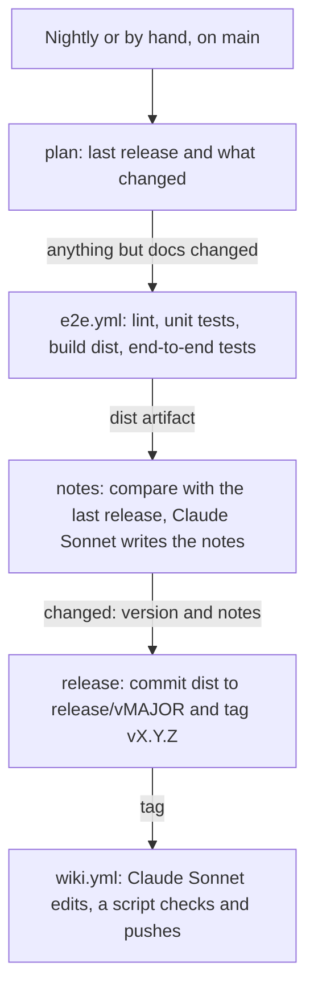

# Releases

How `main` is tested and released, and how the wiki is kept up to date. It's for engineers who change the release, end-to-end or wiki workflows, or want to release outside the nightly run. What runs on a pull request (PR) before it can merge is in [ci.md](ci.md).

## Contents

1. [Overview](#overview)
1. [How it works](#how-it-works)
1. [Release branches](#release-branches)
1. [Versions](#versions)
1. [Release notes](#release-notes)
1. [Wiki](#wiki)
1. [Dependabot](#dependabot)
1. [Security](#security)
1. [Decisions](#decisions)
1. [Limits](#limits)

## Overview

[release.yml](../.github/workflows/release.yml) runs every night at 05:00 UTC, and by hand with `gh workflow run release.yml`. This flowchart shows its jobs:

## How it works

Every job works on the run's commit, `GITHUB_SHA`, so a PR merged during the run isn't released untested. Only code from `main` runs in the workflow.

- **`plan`** fails unless the run is on `main`. It takes the newest published release, rather than the newest tag, so a stray tag can't change the version. It reads which commit on `main` that release was built from, from its commit message, and lists the files changed since.
  - The tests are needed when anything but docs changed: the same `DOCS` paths and Markdown that the `changes` job in [ci.yml](../.github/workflows/ci.yml) skips. That includes a change to CI, tests or dev tooling.
  - With no release yet, everything counts as changed, and the first release is `v0.0.1`.
- **`e2e`** calls [e2e.yml](../.github/workflows/e2e.yml). Its `build` job runs the lint, type check and unit tests, builds `dist/` once and saves it as the `dist` artifact. With that build, the end-to-end jobs install WSL, distributions, images and cloud-init on the `windows-2025`, `windows-2022` and `windows-11-arm` runners, and check that the action fails cleanly on Linux. Nothing is released unless every job passes.
- **`notes`** compares the tested `dist/` and `action.yml` with the last release's. They're all that runners execute, so a change only to tests, CI or docs releases nothing. When they differ, it writes the notes and works out the version. See [Versions](#versions) and [Release notes](#release-notes).
- **`release`** commits the tested `dist/` to the release branch and tags it. See [Release branches](#release-branches).
- **`wiki`** calls [wiki.yml](../.github/workflows/wiki.yml). See [Wiki](#wiki).

`concurrency` lets one run at a time, so a run started by hand can't race the nightly one. The end-to-end tests also run on PRs, as [ci.md](ci.md) describes, and by hand on any branch, with `gh workflow run e2e.yml --ref <branch>`.

## Release branches

`dist/` is never committed to `main`. Each major version has a release branch, `release/v0`, `release/v1` and so on, and every release is one commit on it, tagged `vX.Y.Z`. Users run `@release/v0` for the newest `0.x` release, or a tag to pin one. The `release/` prefix keeps a branch name from ever looking like a release tag.

- The release commit holds every file on `main` at the tested commit except `.github/`, with the tested `dist/` added. Leaving out `.github/` keeps workflow files off the release branches, which the workflow's token can't write.
- Its only parent is the release branch's last commit, or the last release when it starts a new major version. Its message ends `Built from <sha> on main.`, which `plan` reads to find what's changed since.
- The job makes the blobs, tree and commit through the GitHub API, so GitHub signs the commit, and moves the branch only forward. It fails if the tag already exists, because a release attached to an existing tag couldn't be undone.
- `gh release create` then tags the commit and publishes the notes. Immutable releases are on, so the tag can't move or be deleted.
- The `Protect release branches` ruleset stops a `release/*` branch being deleted or force-pushed, and `Protect release tags` stops a `v*` tag being moved or deleted. Admins can bypass both, as on `main`.

## Versions

The version comes from the published releases. Nothing on `main` holds it. What a change does decides the bump, not its commit type. Only a change to the action's source code counts: `src/`, `action.yml` or a runtime dependency bundled into `dist/`.

| Stage | Versions | Breaking change | New feature | Anything else |
| --- | --- | --- | --- | --- |
| Alpha | `0.0.x` | Patch | Patch | Patch |
| Beta | `0.x.y`, from `0.1.0` | Minor | Minor | Patch |
| Stable | From `1.0.0` | Major | Minor | Patch |

- Claude names the most significant change since the last release as `breaking`, `feature` or `other`. The "Work out the version" step applies the table to the last release. In alpha, every release is a patch, whatever Claude says.
- To move to beta or stable, or release early, run the workflow by hand with `version`, such as `gh workflow run release.yml -f version=0.1.0`. It must be newer than the last release, with no leading zeros. It's released even when nothing changed, after the tests pass.
- Mark a breaking change with a `!` in the PR's title, as [Pull requests](../CONTRIBUTING.md#pull-requests) says. Claude also judges the change itself.

## Release notes

Claude Sonnet 5.5 reads every commit on `main` since the last release, with the files each one changes. It returns JSON with the most significant change, its reason and the notes. The notes have Breaking changes, Features, Fixes and Other changes sections, with one bullet per change users can notice and its PR number. The job summary shows the version, the reason and the notes.

## Wiki

The wiki at `https://github.com/froazin/action-wsl-setup/wiki` is the user guide. After each release, `wiki.yml` brings it up to date with that release.

- **`edit`** checks out the release's tag and the wiki. Claude Sonnet 5.5 compares the wiki with `action.yml`, the README, the design docs and the release notes, and changes only what's missing, wrong or out of date. The prompt holds the wiki's format rules, such as no `#` title, `[[Link text|Page-Name]]` links and a `_Sidebar.md` that lists every page. Claude can't delete files, so it marks a page to remove with a single `<!-- remove this page -->` line.
- **`publish`** fails if the edited wiki holds anything but top-level `.md` pages and files in `images/`, including symlinks and agent instruction files such as `CLAUDE.md`. It deletes the marked pages, then commits and pushes to `master`, which publishes at once.
- Run it by hand for a release with `gh workflow run wiki.yml -f tag=v0.1.0`.

## Dependabot

[dependabot.yml](../.github/dependabot.yml) opens npm updates at 01:00 UTC on Mondays and GitHub Actions updates at 01:00 UTC on Wednesdays, with a 7-day cooldown. A maintainer merges them once `CI result` passes, and the next 05:00 run tests and releases them.

- Claude doesn't review them, and CI doesn't check or reword their titles and descriptions.
- A Dependabot commit's body quotes upstream release notes, so the release notes job sees only its header.

## Security

- **Only `main`'s code runs.** No PR's code runs in the release workflow, so nothing can replace the `dist` artifact between the tests and the release.
- **No write token near the build.** The build that makes `dist/` has a read-only token. The jobs that commit and push run no project code.
- **No write token near Claude.** Claude only reads files and returns JSON, or edits a copy of the wiki, in jobs with a read-only token. A separate job without Claude publishes or pushes.
- **Untrusted text stays out.** Dependabot commits' bodies are left out of the release notes. The wiki prompt treats the wiki's pages as data. Only collaborators can edit the wiki, set by "Restrict editing to collaborators only" in the repository's settings. The API can't read that setting, so check it there if it's in doubt.

## Decisions

- **Nightly, not on every merge.** Several merges become one release, and Dependabot's updates ship the morning after they merge.
- **`dist/` on release branches, not `main`.** No PR, Dependabot's included, has to rebuild `dist/`, and what's released is exactly what the end-to-end tests ran.
- **The end-to-end tests on `main` as well as on PRs.** A PR's run tests it alone. The nightly run tests PRs that passed apart but merged together, and builds the exact `dist/` it releases. A broken `main` holds back the release until a fix merges.
- **The wiki from the release workflow.** A release made with the workflow's token doesn't start `on: release` workflows, and the Claude action doesn't support the `release` event.

## Limits

- Release tags are made through the API, so they aren't signed. The commits they point to are, and immutable releases stop the tags moving.
- The end-to-end tests run every night while `main` has changes since the last release that don't change what's released, such as a CI or dev dependency update.
- GitHub turns off a public repository's scheduled workflows after 60 days with no activity. Turn the release workflow back on in the Actions tab.
- The Claude action refuses to run when the workflow's actor is a bot. A scheduled run's actor is whoever last changed its schedule, which is always a maintainer, because people merge every PR. If a run ever fails with "Workflow initiated by non-human actor", run `gh workflow disable release.yml && gh workflow enable release.yml` to make yourself the actor again.
- Dependabot security updates skip the cooldown and `min-release-age`, so one can merge and be released within a day of its publication.
- The end-to-end tests don't run the other actions the workflows use, such as `anthropics/claude-code-action`. A new version of one first runs in the next workflow that uses it.
- Claude's choice of `breaking`, `feature` or `other` is a judgement, and the notes can miss or misdescribe a change. Read the job summary, and edit a release's notes if they're wrong.
- The wiki is pushed without review. Revert a bad change with Git in the wiki clone.
