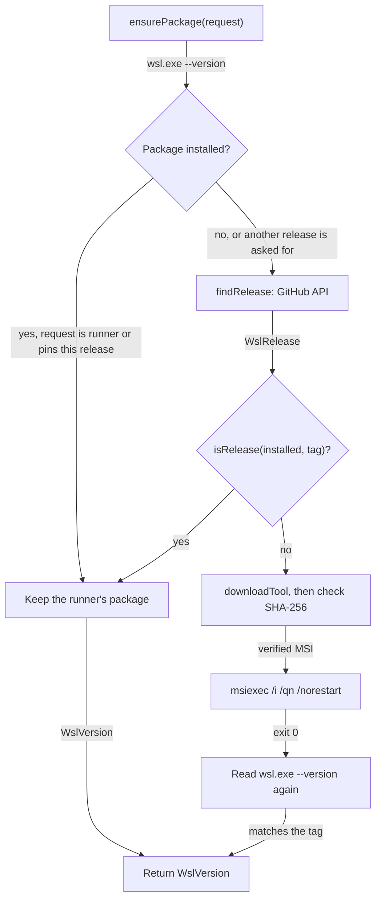

# WSL package

How the action makes sure the right WSL package is installed on the runner before it does anything else. It's for engineers changing [`src/wsl/package.ts`](../src/wsl/package.ts), [`src/wsl/releases.ts`](../src/wsl/releases.ts) or [`src/wsl/exe.ts`](../src/wsl/exe.ts).

## Contents

1. [Overview](#overview)
1. [How it works](#how-it-works)
1. [Interfaces](#interfaces)
1. [Errors and logging](#errors-and-logging)
1. [Security](#security)
1. [Decisions](#decisions)
1. [Limits](#limits)
1. [Sources](#sources)

## Overview

Windows has two `wsl.exe` programs. The inbox one in `System32` is a stub on current Windows, and on the `windows-11-arm` image it refuses even `--install` and `--update` (observed). The WSL package, an MSI published on [microsoft/WSL's releases](https://github.com/microsoft/WSL/releases), installs the real `wsl.exe` in `%ProgramFiles%\WSL`, along with `wslc.exe` from 3.0.1 onwards.

The hosted images differ (observed on 2026-10-28):

| Image | WSL package at job start |
| --- | --- |
| `windows-2025` | 3.0.3.0, from the image build |
| `windows-2022` | None. Only the inbox stub |
| `windows-11-arm` | None. Only the inbox stub |

`ensurePackage` turns the `wsl-package-version` input into a `PackageRequest` and installs a release only when the runner's package doesn't satisfy it.

## How it works

This flowchart shows how `ensurePackage` decides whether to install a release:

- **Request:** `parsePackageRequest` maps an empty input to `runner`, `latest` to `latest`, and a release such as `3.0.3` (or `3.0.3.0`, or `v3.0.3`) to `exact`. Anything else fails before the action changes the runner.
- **Installed version:** `installedVersion` runs `%ProgramFiles%\WSL\wsl.exe --version`. When that file doesn't exist, no package is installed. Straight after an install, `wsl.exe` can print "WSL is finishing an upgrade" first, so it retries for up to about 30 seconds.
- **Matching:** a package reports four parts, such as `3.0.3.0`, and a release tag three, such as `3.0.3`. `isRelease` compares every part, treating missing parts as `0`. A pin the runner already has is kept without a lookup, so it works without access to GitHub's API.
- **Release lookup:** `findRelease` reads `releases/latest` or `releases/tags/<tag>` from the GitHub API. `latest` never returns a prerelease. It tries three times when the request fails or GitHub returns a server error, and gives each try 30 seconds.
- **Architecture:** `nativeArch` reads `PROCESSOR_ARCHITECTURE` from the registry with `reg.exe`, because `process.arch` is Node's architecture, which is x64 when an x64 runner runs under emulation on ARM64 Windows. `toWslRelease` picks the `wsl.<version>.<arch>.msi` asset for it, and its `sha256:` digest.
- **Install:** the MSI downloads into a new `wsl-<uuid>` directory under `RUNNER_TEMP`, because `downloadTool` won't overwrite a file and a job can install the same release twice. Its SHA-256 is checked against GitHub's digest, and `msiexec` installs it quietly with a verbose log. The MSI allows downgrades, so an exact pin can be older than the runner's package (observed on `windows-2025`, from 3.0.3.0 to 2.7.14.0).
- **wslc:** `wslcPath` returns `%ProgramFiles%\WSL\wslc.exe` when it exists, for the `wslc-path` output.

## Interfaces

- **Inputs:** `wsl-package-version` and `token`, described in [`action.yml`](../action.yml).
- **Outputs:** `wsl-package-version`, `kernel-version` and `wslc-path`.
- **`wsl(args)`:** every call to `wsl.exe` goes through it. It runs the package's `wsl.exe` by absolute path, with `WSL_UTF8=1` and stdin closed, and returns the exit code and the combined output.
- **`parseVersion`:** reads the first two `label: value` lines of `wsl --version` by position, because the labels are translated on non-English Windows.
- **`parseErrorCode`:** finds a `Wsl/.../SYMBOL` error code in `wsl.exe`'s output. The code isn't translated.

## Errors and logging

- Every failure is an `Error` with a message for the workflow's user. `run` in [`src/main.ts`](../src/main.ts) catches it and fails the step with `core.setFailed`.
- A failed `msiexec` prints the last 40 lines of its log. The log is UTF-16LE.
- `msiexec` exit codes 3010 and 1641 mean Windows must restart, which can't happen during a job, so they fail with that reason.
- `msiexec` exit code 1618 means another Windows Installer transaction is running, such as an update. The action tries again every 15 seconds for about 5 minutes before it fails.
- A failed release lookup names the URL and the reason fetch gives, such as a DNS error.
- An install whose `wsl --version` doesn't report the requested release fails rather than carrying on with the wrong package.

## Security

- The token only goes to `api.github.com`, and only when `GITHUB_SERVER_URL` is `https://github.com`, because on GitHub Enterprise Server `github.token` isn't valid for github.com.
- The MSI must match the SHA-256 digest GitHub reports for the asset. If GitHub reports none, the action warns and installs it unverified.
- The `wsl-package-version` input is validated as a version before it reaches a URL.

## Decisions

- **Install from the MSI, not `wsl --update`.** The inbox `wsl.exe` on `windows-11-arm` refuses `--update`, and the MSI can be pinned and checked against its digest. `wsl --update` can only go to the newest version.
- **Keep the runner's package by default.** It avoids a download of about 350 MB on `windows-2025`, and the image already tracks new WSL releases.
- **No runner checks.** The action supports every hosted Windows image and self-hosted runners, so it relies on what WSL itself reports.
- **`wslc` is an output, not a version level.** It comes with the package from 3.0.1, not with the instance's WSL version.

## Limits

- `latest` and an empty input on a runner without a package install whatever release is newest at the time, so two runs can get different versions. Pin a release for repeatable runs.
- Installing the same release the Store package already has fails with `msiexec` exit code 1603 (observed on `windows-2025`). `isRelease` stops that case before `msiexec` runs.
- Release lookups use the GitHub API's rate limit for the token.

## Sources

- https://github.com/microsoft/WSL/releases
- https://learn.microsoft.com/en-us/windows/wsl/basic-commands
- https://learn.microsoft.com/en-us/windows/win32/msi/error-codes
