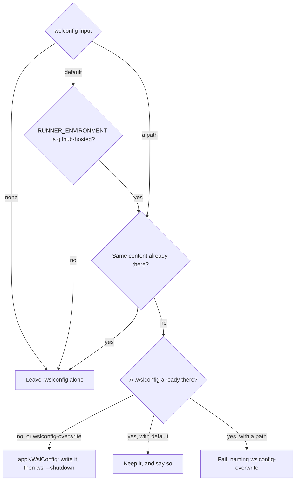

# .wslconfig

How the action decides whether to write `%USERPROFILE%\.wslconfig`, and how it applies it. It's for engineers changing [`src/wsl/config.ts`](../src/wsl/config.ts) or the `wslconfig` inputs.

## Contents

1. [Overview](#overview)
1. [How it works](#how-it-works)
1. [Interfaces](#interfaces)
1. [Errors and logging](#errors-and-logging)
1. [Decisions](#decisions)
1. [Limits](#limits)
1. [Sources](#sources)

## Overview

WSL reads `.wslconfig` from the user's profile when its virtual machine starts. The action decides what to do with the other input checks, before anything changes on the runner. It writes the file after [the WSL package](wsl-package.md) is in place and the distribution checks have passed, and before it [installs a distribution](distributions.md), so every instance it starts uses it.

`planWslConfig` decides what to do from the `wslconfig` input, the file that's already there, the kind of runner and `wslconfig-overwrite`. This flowchart shows its decisions:

## How it works

- **Inputs first:** `parseWslConfigRequest` reads the `wslconfig` input and `checkWslConfig` plans against the `.wslconfig` that's there, with the other input checks in `run()`. A missing file, a directory or a conflict with an existing `.wslconfig` fails before anything changes on the runner. A path is resolved against `GITHUB_WORKSPACE` by `resolveInputPath` in [`src/files.ts`](../src/files.ts), which the cloud-init inputs use too.
- **Order:** `run()` checks the instance name is free and finds the distribution's image before `applyWslConfig`, because those checks can fail on the inputs, and a failed run shouldn't replace `.wslconfig` or stop running instances.
- **Planning:** `planWslConfig`, which `checkWslConfig` calls, is a pure function of the request, the existing content, whether the runner is hosted and `wslconfig-overwrite`, so its unit tests cover every branch.
- **Kind of runner:** the runner sets `RUNNER_ENVIRONMENT` to `github-hosted` on GitHub-hosted runners and `self-hosted` on others.
- **Applying:** `applyWslConfig` carries out the plan. It writes the file, then runs `wsl --shutdown`, because WSL only reads `.wslconfig` when its virtual machine starts. It lists running instances first with `wsl --list --running --quiet`, and warns with their names when the shutdown stopped any.
- **Content:** the action writes the file as it's given. WSL reads LF and CRLF line endings alike (inferred), so it doesn't normalise them, and compares content exactly.

## Interfaces

- **Inputs:** `wslconfig` (`default`, `none` or a path) and `wslconfig-overwrite`, described in [`action.yml`](../action.yml) and the README.
- **`RUNNER_WSLCONFIG`:** the content `default` writes: `[wsl2] guiApplications=false` and `[general] instanceIdleTimeout=-1`.

## Errors and logging

- A path that doesn't exist or isn't a file fails before the runner changes, naming the input.
- A path whose content differs from an existing `.wslconfig` fails without `wslconfig-overwrite`, naming the file and the input, before the runner changes.
- A failed `wsl --shutdown` fails the step, because instances could then start with the old settings.
- Every decision not to write is logged with its reason.

## Decisions

- **`default` only writes on GitHub-hosted runners.** A self-hosted runner is someone's machine, and `.wslconfig` would outlive the job and change every instance on it. `wslconfig-overwrite` doesn't change that, because `default` is what a workflow gets without asking. To write on a self-hosted runner, pass a path.
- **Fail rather than replace with a path.** The user asked for this: a `.wslconfig` that's already there is someone's own, so replacing it needs `wslconfig-overwrite`.
- **Keep an existing file with `default`.** Failing would break every workflow on a runner image that ships a `.wslconfig`, for settings the workflow never asked for.
- **Two settings in the default.** `guiApplications=false`, because jobs run without a desktop session. `instanceIdleTimeout=-1`, from the user's dotfiles, so an idle instance keeps running between steps and its services don't start again each time. The end-to-end `default` and `none` cases check that an idle instance keeps running with it and stops without it. Memory and processors keep WSL's own defaults.
- **No post step.** The action doesn't remove or restore `.wslconfig` afterwards. Hosted runners are thrown away, and on a self-hosted runner it only writes the file the workflow passed.

## Limits

- Settings that need a reboot, or a newer WSL than the runner has, aren't checked. WSL ignores keys it doesn't know (inferred).
- `wsl --shutdown` stops every running instance, including ones another step started.

## Sources

- https://learn.microsoft.com/en-us/windows/wsl/wsl-config
- https://docs.github.com/en/actions/reference/workflows-and-actions/variables
